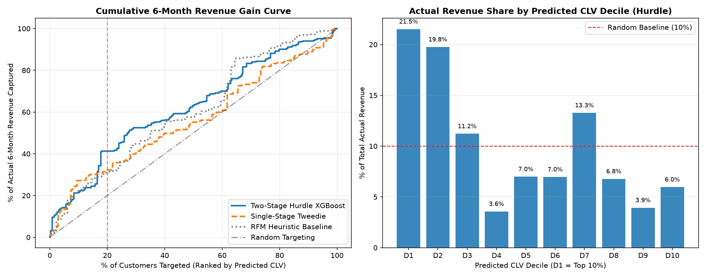
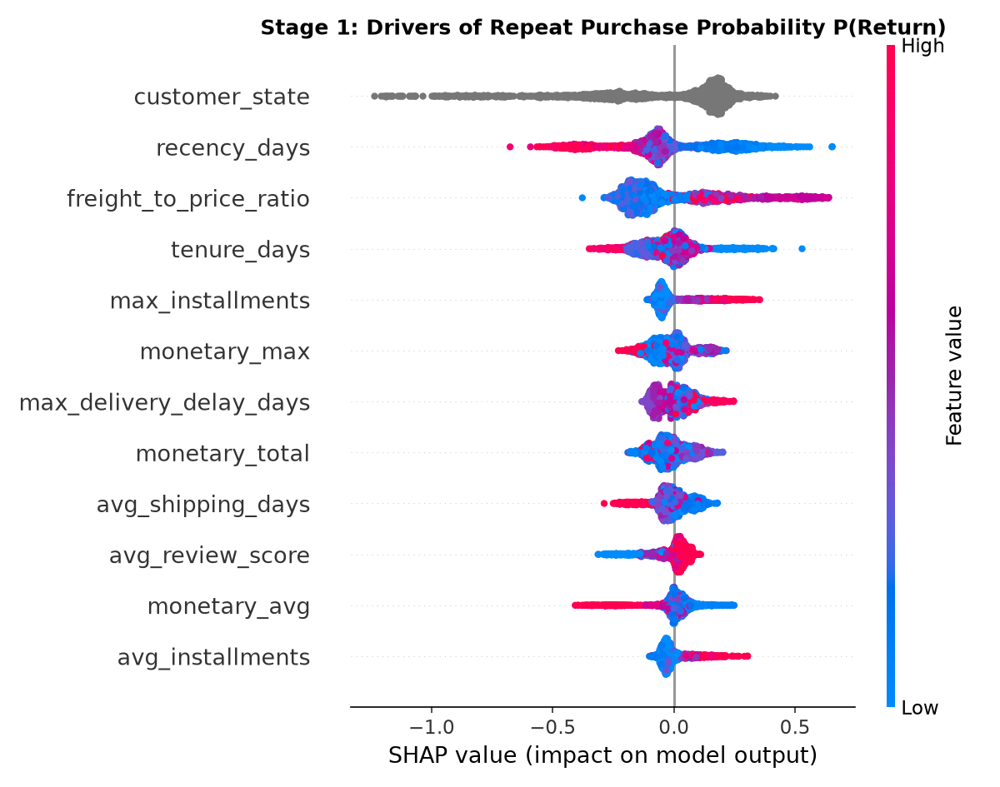
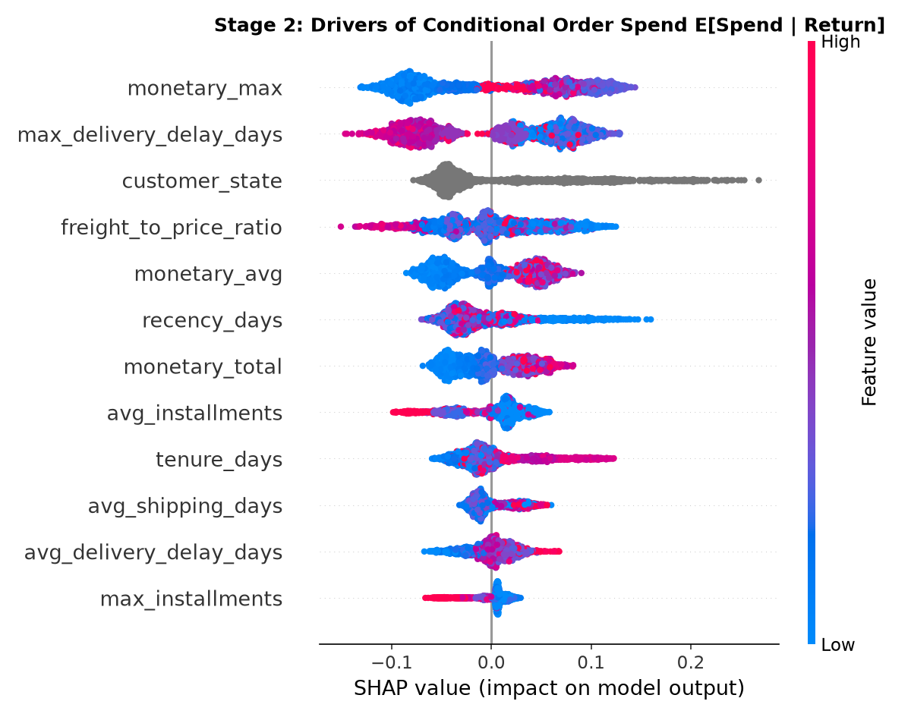

# Olist E-Commerce: Customer Lifetime Value (CLV) & Retention ROI Simulator

An end-to-end **Customer Lifetime Value (CLV)** modeling and marketing unit-economics pipeline built on the **Olist Brazilian E-Commerce** relational dataset. Using a **DuckDB SQL feature store**, a **Two-Stage Hurdle XGBoost architecture**, **TreeSHAP explainability**, and an interactive **Streamlit ROI simulator**, this project solves extreme zero-inflation (~98.8% non-repeat rate) to turn unprofitable blanket retention campaigns into **+76.1% blended ROI**.

---

## Business Problem & Dataset Nuances

In non-contractual e-commerce marketplaces like Olist, predicting future customer spend faces two structural challenges:
1. **Order-Level Customer IDs:** Olist generates a new `customer_id` for every transaction. All aggregations must be resolved at the `customer_unique_id` level to track longitudinal customer behavior.
2. **Severe Zero-Inflation (~1.18% 6-Month Repeat Rate):** Because nearly 99% of customers spend **R$ 0** in the 6-month target window, standard single-stage MSE regression collapses toward zero, and blanket discount vouchers lose over **R$ 41,000** across a 11,054-customer cohort.

---

## Methodology & Architecture

### 1. Temporal Split (Zero Data Leakage)
* **Observation Window ($X$):** `2017-01-01` to `2018-02-28` (14 months; `55,267` unique customers with delivered orders).
* **Prediction Window ($y$):** `2018-03-01` to `2018-08-31` (6 months; `1.18%` repeat purchase rate, **R$ 23,812** realized test-set revenue across `11,054` holdout customers).
* **Pre-Aggregation SQL Pipeline (`src/build_features.py`):** Uses DuckDB to pre-aggregate `order_payments`, `order_items`, and `order_reviews` to `order_id` before joining, preventing cartesian row multiplication across 23 behavioral, operational, and RFM features.

### 2. Two-Stage Hurdle Model
$$\widehat{\text{CLV}}_{6\text{m}} = P(\text{Return} = 1 \mid X) \times \mathbb{E}[\text{Spend} \mid \text{Return} = 1, X]$$

* **Stage 1 — Repeat Purchase Classifier:** `XGBClassifier` predicting 6-month return probability $P(\text{Return})$. Diagnostics confirmed raw log-loss probabilities achieve exact base-rate calibration (**1.176%** predicted vs. **1.176%** actual) and superior **PR-AUC (0.0386)** compared to post-hoc Sigmoid (0.0347) and Isotonic (0.0342) wrappers[cite: 1].
* **Stage 2 — Conditional Spend Regressor:** `XGBRegressor` trained on $\log(1 + \text{spend})$ exclusively for repeat buyers, back-transformed with **Duan's smearing correction** to eliminate retransformation bias.

---

## Model Benchmark & Results (Test Set: $N = 11,054$)

| Model | Total Pred Rev (R$) | RMSE | MAE | Spearman R | Top 10% Rev Share | Top 20% Rev Share | Top 10% Lift |
| :--- | :---: | :---: | :---: | :---: | :---: | :---: | :---: |
| **1. RFM Heuristic Baseline** | R$ 20,026 | 33.23 | 3.91 | 0.0243 | 21.14% | 31.39% | 2.11x |
| **2. XGBoost Tweedie (1-Stage)** | R$ 13,213 | 33.20 | 3.30 | 0.0243 | 27.19% | 32.20% | 2.72x |
| **3A. Hurdle (Isotonic Calibrated)** | R$ 18,747 | 33.20 | 3.77 | 0.0254 | **27.66%** | 37.22% | **2.77x** |
| **3B. Hurdle (Uncalibrated XGB)** | R$ 18,502 | **33.17** | **3.75** | **0.0265** | 21.52% | **41.28%** | 2.15x |

### Key Analytical Findings
* **Top-Quintile Revenue Concentration:** The uncalibrated Two-Stage Hurdle model captures **41.28%** of actual 6-month revenue within the **Top 20% (D1–D2)** of customers and **52.5%** within the **Top 30% (D1–D3)**—nearly **+10 percentage points higher** than single-stage Tweedie (32.20%) and the RFM heuristic (31.39%)[cite: 2].
* **Opposing Stage 1 vs. Stage 2 Drivers (TreeSHAP):**
  * **Stage 1 ($P(\text{Return})$):** Driven primarily by geographic logistics (`customer_state`), purchase recency (`recency_days`), `freight_to_price_ratio`, and installment usage (`max_installments`). Everyday, lower-ticket buyers return more frequently than one-off big-ticket buyers[cite: 3].
  * **Stage 2 ($\mathbb{E}[\text{Spend} \mid \text{Return}]$):** Driven by historical peak spend (`monetary_max`) and operational delivery reliability (`max_delivery_delay_days`)—severe prior delivery delays sharply shrink repeat basket size even when customers return[cite: 4].





---

## Multi-Channel Retention Policy & Unit Economics

Assuming a **50% gross margin** and **+30% relative lift** in return probability, routing customers to channels matched to their expected incremental gross profit ($\Delta P \times \widehat{\text{Spend}}_{\text{cond}} \times 50\%$) transforms retention economics:

| Assigned Channel | Customers (% of Base) | Avg Pred 6M CLV | Campaign Cost (R$) | Incr. Gross Profit (R$) | Net Profit (R$) | ROI (%) |
| :--- | :---: | :---: | :---: | :---: | :---: | :---: |
| **Tier 1: R$ 4.00 Voucher** | 11 (0.1%) | R$ 40.81 | R$ 44.00 | R$ 67.34 | **+R$ 23.34** | **+53.04%** |
| **Tier 2: R$ 0.25 Email / App Push** | 3,597 (32.5%) | R$ 2.95 | R$ 899.25 | R$ 1,593.89 | **+R$ 694.64** | **+77.25%** |
| **Tier 3: No Paid Spend (R$ 0)** | 7,446 (67.4%) | R$ 1.00 | R$ 0.00 | — | — | — |
| **Total Active Program (Tiers 1 + 2)** | **3,608 (32.6%)** | **R$ 3.07** | **R$ 943.25** | **R$ 1,661.23** | **+R$ 717.98** | **+76.12%** |

---

## Repository Structure

```text
olist_clv/
├── app/
│   └── streamlit_app.py                # Interactive CLV & Retention ROI Simulator
├── data/
│   ├── raw/                            # Raw Olist CSVs (downloaded via kagglehub)
│   └── processed/                      # DuckDB feature matrix, predictions & benchmark CSV
├── models/                             # Serialized XGBoost Hurdle & Tweedie artifacts
├── notebooks/
│   ├── 01_eda_and_cohorts.ipynb        # Cohort retention heatmap & operational churn EDA
│   └── 02_modeling_and_evaluation.ipynb# Calibration curves, benchmarks, SHAP & policy sim
├── reports/
│   └── figures/                        # High-DPI Decile Lift & TreeSHAP summary plots
├── src/
│   ├── download_data.py                # Automated Kaggle dataset ingestion
│   ├── build_features.py               # DuckDB relational SQL feature engineering pipeline
│   ├── train_evaluate.py               # Model training, Duan smearing & decile evaluation
│   └── visualize_results.py            # Automated PNG figure generation
├── .gitignore
├── requirements.txt
└── README.md
```
## Quickstart & Setup

### 1. Install Dependencies

```bash
pip install -r requirements.txt
```

### 2. Run the End-to-End Pipeline

```bash
# Download raw Olist CSVs into data/raw/
python src/download_data.py

# Build leak-free observation/target feature matrix via DuckDB
python src/build_features.py

# Train Hurdle, Tweedie, and RFM models & evaluate on holdout cohort
python src/train_evaluate.py

# Generate Decile Lift and TreeSHAP visual diagnostics
python src/visualize_results.py
```

### 3. Launch the Interactive Retention ROI Simulator

```bash
python -m streamlit run app/streamlit_app.py
```